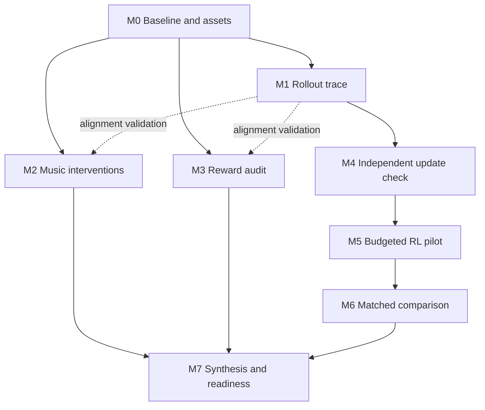

# Bailando++: exploration and deep-replication plan

Updated: November 6, 2026. Owner: Alex, with joint replication reviews.

This replaces the original-Bailando plan in the chat. It is a short, staged pilot
using Modal GPUs and approximately $250 in project credits. The goal is to explain
one complete RL update and establish an evidence-backed limitation before changing
the reward or algorithm. A useful negative result counts; improvement is not a
prerequisite for successful replication of the procedure.

## 1. Baseline and verified corrections

Use the official **Bailando++ TPAMI 2023** implementation at upstream commit
`cc90b98bff81c9709570db413c9610c2562e27ca`, inspected on November 6. Check this
revision out during setup and record any compatibility patch separately.
The supervised ++ policy and position decoder are downloaded and metadata-verified;
successful model loading remains a gate. Two development pairs are now validated
in `reports/batch01/data_validation.md`. Their music supports 20-second generations,
but real excerpts last only 7.1 and 7.383 seconds. The first reward audit therefore
uses [2, 6) seconds for every control; generated-only music comparisons use [5, 15).

| Item | Verified source behavior | Implication for our work |
|---|---|---|
| Policy | `CrossCondGPT2MWAC` adds a music-context Transformer | Trace music context, padding, downsampling, and look-ahead, not just motion history. |
| RL configuration | `actor_critic_music_trans_400.yaml` uses `SepVQVAER` and position decoding | Preserve this reward path for released-code replication. |
| Rendering configuration | `actor_critic_music_trans_400_mix_rotmat.yaml` uses `SepVQVAERmix` | Label rotation/SMPL rendering separately; compare checkpoints with the same decoder. |
| Beat reward | The ++ code already enables positive reward for intervals without a music beat | Withdraw the earlier original-Bailando code/paper discrepancy. Audit this behavior as part of the ++ baseline. |
| Optimization defaults | Batch size 64; five actor then five critic minibatches; discount 1; entropy coefficient 0; body reward weight 0 | The previous batch-size-128 assumption is superseded. Ensure small runs actually reach critic updates. |
| Update paths | Music encoder and GPT base execute under `no_grad` in actor/critic methods; actions use top-1 selection | Verify parameter changes and explain greedy rollouts rather than assuming stochastic sampling. |
| Training data source | RL generation uses `test_loader`; supplied train/test paths match | Explicitly isolate adaptation and held-out songs in the actual rollout loader. |

Sources: [++ training configuration](https://github.com/lisiyao21/Bailando/blob/cc90b98bff81c9709570db413c9610c2562e27ca/tpami_bailandopp/configs/actor_critic_music_trans_400.yaml),
[rendering configuration](https://github.com/lisiyao21/Bailando/blob/cc90b98bff81c9709570db413c9610c2562e27ca/tpami_bailandopp/configs/actor_critic_music_trans_400_mix_rotmat.yaml),
[policy implementation](https://github.com/lisiyao21/Bailando/blob/cc90b98bff81c9709570db413c9610c2562e27ca/tpami_bailandopp/models/cross_cond_gpt2_music_window_ac.py),
[reward](https://github.com/lisiyao21/Bailando/blob/cc90b98bff81c9709570db413c9610c2562e27ca/tpami_bailandopp/models/up_down_half_reward.py),
[training loop](https://github.com/lisiyao21/Bailando/blob/cc90b98bff81c9709570db413c9610c2562e27ca/tpami_bailandopp/actor_critic.py).

The intended model comparison is **++ supervised GPT versus that same policy
after our RL fine-tuning**. A released post-RL checkpoint can be an additional
reference, but cannot substitute for the supervised starting point or prove that
we reproduced training. Locate the supervised music-Transformer checkpoint, the
position VQ-VAE checkpoint inherited from original Bailando, and the ++ rotation
decoder checkpoint separately. Do not treat a shared filename as checkpoint identity.
The [++ README](https://github.com/lisiyao21/Bailando/blob/cc90b98bff81c9709570db413c9610c2562e27ca/tpami_bailandopp/README.md)
documents the pretrained package and separate training/rendering routes.

## 2. Resource and budget strategy

Use local development plus bounded Modal Functions. Cache assets in a Modal
Volume; persist run outputs before exit. CPU-only downloads and image builds
precede GPU execution. Start with one T4 for compatibility testing. GPU choice is
provisional until a successful representative run establishes memory and runtime.
The upstream environment specifies PyTorch 1.6.0; neither a legacy container nor
a modernized environment is assumed to work without testing. First try the
legacy project environment in a container, isolating it from Modal's launcher
runtime if necessary. If that fails, document the failure and test a pinned
compatibility port against the same numerical fixtures. Never silently label a
port as an exact historical-environment reproduction.

| Stage | Incremental allowance | Cumulative exploration allowance |
|---|---:|---:|
| First batch: asset checks, environment, tiny music/reward tests | $10 ($5 setup + $5 diagnostics) | $10 |
| Expand diagnostics and complete rollout trace | $10 | $20 |
| Independent update verification and training-cost benchmark | $10 | $30 |
| Later RL pilot, only after verification and cost estimate | Proposed $20 from remaining credits | Separate from exploration |

These are proposed ceilings including supporting resources, not runtime promises.
Reserve approximately $220 after exploration; a subsequent $20 pilot would leave
approximately $200. Do not count recurring free credits on top of the grant until
the account confirms eligibility, stacking, and expiration.

GPU-only reference prices checked November 6: T4 $0.5904/hour, L4 $0.7992/hour,
A10 $1.1016/hour, A100 40 GB $2.0988/hour. CPU/RAM and applicable storage/network
charges are additional. Use measured cost per completed rollout/update to choose
between compatible GPUs, not hourly price alone. [Modal pricing](https://modal.com/pricing)

Operational defaults:

- First GPU smoke test: 15-minute timeout, one GPU container, no automatic retries,
  no warm minimum containers. Increase a timeout only from measured work duration.
- First-batch subsequent jobs: at most 30 minutes each; preflight the remaining
  allowance before launch. Reserve 20% of remaining allowance for overhead and
  accounting uncertainty. Log estimates and reconcile actual usage after each job.
- On a dedicated workspace, initially cap usage at $10, then raise to $30 for the
  next stages. Account for existing cycle usage if present. On a shared workspace,
  coordinate the overall cap rather than interrupting another project's jobs.
- Modal usage budgets are monthly and before credits; net spend limits are after
  credits. Track cumulative project consumption separately across billing cycles.
  Environment budgets require Team/Enterprise; do not upgrade just for this pilot.
  [Modal budget rules](https://modal.com/docs/guide/budgets)
- Cache rollouts, decode once per representation, and rescore cached motion.
  Reward helpers currently contain CUDA calls: either use a brief GPU scoring job
  or validate a device-neutral scoring adapter before moving scoring to CPU.
- Persist checkpoints with optimizer, scheduler, RNG state, progress, and manifest
  for resumable training. Verify reload behavior before relying on resumption.
  [Modal persistent Volumes](https://modal.com/docs/guide/volumes)

## 3. Modules, ownership, and deliverables

Alex owns implementation and the policy/reward evidence. Joint work means both
teammates independently explain/check the result; it does not reassign the
teammate's representation exploration. Each module saves a short finding, its
underlying records, and at least one viewable figure/table/clip.

| Module | Work and dependency | Text deliverable | Visual deliverable | Completion gate |
|---|---|---|---|---|
| M0 — Agree on baseline | Pin ++ source; inventory assets; create environment; generate a supervised example. No dependency. | Baseline manifest, checkpoint-loading report, compatibility deviations. | Asset/configuration table and synchronized skeleton clip. | Both identify the exact pre-RL policy, decoder, split, and baseline behavior. |
| M1 — Trace rollout | Trace features → music encoder + code history → code action → decoded motion → reward. After M0. | One indexed walkthrough, including window boundaries and music look-ahead. | Tensor/time alignment diagram and beat/reward timeline. | Both can locate one action's conditioning, frames, reward, and bootstrap value. |
| M2 — Change music | Fix initial codes; compare original, swapped, and shifted music. Start after M0; interpret after M1 alignment checks. | Findings separating conditioning sensitivity from improved timing. | Paired metric table, beat overlays, two side-by-side clips. | Comparisons use identical initialization, duration, decoder, and valid overlap. |
| M3 — Audit reward | Score real, reconstructed, generated, shifted, repetitive, and nearly stationary motion. After M0; validate alignment with M1. | Supported reward successes/failures, including negative findings. | Ranking table, shift-response curve, annotated examples. | Every claimed failure has a reproducible input and its reward components. |
| M4 — Verify update | Independently calculate a fixed batch and inspect actor and critic steps. After M1. | Worked TD targets/losses and two independent explanations. | Manual/runtime agreement table and gradient/parameter-change heatmap. | Values match, frozen modules are verified, and all observed parameter changes are explained. |
| M5 — Reproduce RL procedure | Start from supervised ++ weights; adapt on designated songs with original objective. After M0/M1/M4 and budget gate. | Run record, checkpoint lineage, update counts, measured cost. | Reward/TD curves and checkpoint table. | Both update types execute; adaptation split is enforced; saved state reloads. |
| M6 — Compare before/after | Evaluate matched no-RL and our-RL policies. Prepare tooling early; results require M5. | Improvement/regression account by evaluation group. | Small comparison table, paired song-level plots, three paired videos. | All evaluation settings and decoder choices match. |
| M7 — Explain result | Integrate M2–M6 and teammate representation findings. | Two-page synthesis, limitation statement, next test. | Claim-to-evidence table and example gallery. | Both explain a complete update and identify an evidence-backed limitation. |



Run M1 source analysis alongside M2/M3 artifact analysis. While the GPU is running,
work locally on independent calculations, plots, and report text. Share immutable
assets and give each run a distinct output directory. Avoid parallel GPU jobs
during initial debugging; concurrency becomes useful only after timing and cost
are understood. Ask the teammate for reconstruction examples and independent
update calculations; no additional agent delegation is required.

## 4. Experiment and verification protocol

### Common evaluation contract

The first batch uses two songs and one fixed initial upper/lower code pair.
Expand after its acceptance gate to six distinct songs across three available
genres, with three adaptation songs and three held out from RL. Split by underlying
music ID, grouping all recordings/dances using that music. If three genres are
unavailable, retain song-disjointness and document reduced genre coverage.

Use two fixed initial code pairs across the six-song evaluation set: 12 cases
per checkpoint. The two first-batch songs become adaptation/development cases;
held-out results must not drive checkpoint or hyperparameter selection. Record
supervised-training overlap when known. Describe the second group as "held out
from RL" unless exclusion from supervised training is also verified.

Hold preprocessing, coordinate system, decoder hash, initialization, evaluation
duration, and generation mode fixed. First-batch short clips are diagnostics.
For later matched evaluation generate complete selected tracks, retaining the
released context/padding behavior; choose display excerpts only afterward.
Run greedy inference in evaluation mode. Repeated inference seeds are not
independent diversity samples.

Record raw decoder output used by reward separately from global positions used
for visual metrics. Root velocity slots must not be interpreted as positions;
integrate velocity using the repository's convention before measuring root travel.
For primary RL comparisons use the position decoder consistently. Rotation/SMPL
rendering is a separately labeled validation path with the same rotation decoder
on both policies. Never mix those paths in one metric column.

| Measurement | Definition and interpretation |
|---|---|
| Reward | Mean total reward, beat component, body component, and fraction of positive bins; additionally stratify on music-beat-containing bins. |
| Timing | Mean distance from motion beats to nearest music beat; music-beat coverage within 100 ms; report both beat counts. No motion beats means undefined timing error, not zero. |
| Smoothness | RMS acceleration and jerk from consistently scaled joint positions with verified timestep; state whether root-relative or global. |
| Movement | Mean root-relative joint speed and global root travel, separately. Lower jerk with collapsed movement is not an unqualified gain. |
| Diversity | Mean pairwise distance between per-clip vectors of mean/std joint speeds across matched-length cases; report within-song differences across starts separately. Add code occupancy and repeated-code runs as proxies, not substitutes for motion diversity. |
| Visual quality | Both teammates review timing, continuity, movement, repetition, and obvious distortion in synchronized clips; preserve disagreements. |

Timing metrics share detector assumptions with the reward, so do not describe
them as fully independent validation. Inspect plots and videos as well. Aggregate
initializations within song before reporting group mean/range. Show the individual
song deltas; no significance or broad-generalization claim from three held-out songs
and one training seed. Do not make small-sample FID the primary result.

### Music interventions and reward controls

M2 changes conditioning, keeping the initial code pair fixed. Compare original,
another song, and a shifted version with consistently shifted features, beat
labels, and display audio. Retain real context and evaluate a common valid
interval; never wrap shifted features around the song boundary. A changed code
sequence establishes sensitivity; improved alignment to the changed music is a
separate claim. Include an identical-input rerun to quantify reproducibility.

M3 changes motion while holding the music fixed. Use matched duration and valid
coordinates. Add reconstruction to the requested five motion categories to help
attribute failures to representation versus policy. Sweep motion offsets from
-0.5 to +0.5 seconds at native-frame resolution on cached data, scoring a common
interior interval and grouping into the original eight-frame reward bins.
Inspect repetition seams and compute movement statistics for stationary controls.
Do not silently replace NaNs with zeros. Keep an exact stationary control and a
small-motion control; detector behavior can differ between them.

For finite, nondegenerate inputs and the default zero body weight, the ++ beat
reward's truth table is:

| Music beat in eight-frame bin | Motion beat in bin | Beat reward |
|---|---|---:|
| No | Either | +5 |
| Yes | Yes | +5 |
| Yes | No | -5 |

Thus sparse music beats can produce a favorable total even with little beat
matching. This is a hypothesis to test with real inputs, not an already observed
failure. Always report beat-bin density and conditional beat-bin performance.
Source: [++ reward](https://github.com/lisiyao21/Bailando/blob/cc90b98bff81c9709570db413c9610c2562e27ca/tpami_bailandopp/models/up_down_half_reward.py).

### One rollout and one update

Export an initial window and a later overlapping window. Show the native music
frame rate, eight-frame code conversion, padded music context, action indices,
reward frames, next-state value, and overlap masks. Use the actual ++ slicing;
do not reuse an original-Bailando tensor diagram. The music encoder has access
to surrounding music; distinguish available song look-ahead from future generated
motion. Inspect crop-decoding versus full-sequence-decoding boundaries.

For the default zero-entropy, unit actor-scale configuration, independently compute:

```text
y[t]     = reward[t] + gamma * value[t+1]
delta[t] = stop_gradient(y[t]) - value[t]
CE[t]    = CE_upper[t] + CE_lower[t]
L_actor  = sum(mask[t] * CE[t] * stop_gradient(delta[t])) / sum(mask)
L_critic = mean(delta[t] ** 2)
```

The actor is masked; the released critic reduction is unmasked. Verify this and
the detached bootstrap against a saved batch, including one partially masked
window. Compare independently calculated values with float32 runtime values using
`atol=1e-6, rtol=1e-5`. Record errors rather than widening tolerance to hide a
mismatch. Check one actor step and one critic step on disposable checkpoint copies.
[++ update implementation](https://github.com/lisiyao21/Bailando/blob/cc90b98bff81c9709570db413c9610c2562e27ca/tpami_bailandopp/actor_critic.py)

Inspect gradient existence/norms, optimizer membership, parameter deltas, and
dropout mode for VQ-VAE, music encoder, GPT base, actor head, and critic head.
Confirm unchanged VQ-VAE/music/base weights. Explain any inactive-head movement:
Adam state and version-dependent `zero_grad` behavior can matter even when there
is no new loss gradient. Preserve observed baseline behavior rather than silently
repairing it. Explain top-1 action selection and its implications for the estimator.
Save initial states as well as seeds to avoid relying on initialization order.

### RL pilot and matched comparison

Keep the supervised checkpoint immutable. Preserve the released objective,
discount, optimizer hyperparameters, five/five branch schedule, and greedy rollout
generation. Make the actual rollout loader adaptation-only; evaluate held-out
tracks through a separate path. Verify song IDs at runtime.

Choose the largest batch size no greater than 64 that both fits memory and yields
at least ten minibatches per epoch, so the schedule reaches both branches. Record
this as a small-data/budget deviation. Do not duplicate samples just to reach a
desired minibatch count. If fewer than ten usable windows exist, increase the
adaptation duration before training.

After timing a representative rollout and complete update cycle, estimate total
epoch cost including all adaptation generation, scoring, updates, and checkpoint
overhead. Predeclare the largest number of complete epochs up to five that fits
80% of the proposed $20 pilot allowance, reserving the balance for evaluation and
overhead. If even one epoch does not fit, report the estimate and defer the run.
Use seed 42 for the pilot and its final completed scheduled epoch as the primary
endpoint. Do not choose a checkpoint using held-out results. Interrupted or
shorter-than-planned work is labeled partial; never claim paper-scale reproduction.

Save supervised-versus-RL table rows separately for adaptation and held-out songs:

| Group | Checkpoint | Reward | Beat error / coverage | Jerk | Joint speed / root travel | Diversity |
|---|---|---|---|---|---|---|
| Adaptation | Supervised / our RL / paired change | Pending | Pending | Pending | Pending | Pending |
| Held out from RL | Supervised / our RL / paired change | Pending | Pending | Pending | Pending | Pending |

Select illustrative before/after clips by largest, median, and smallest reward
change, and add a reward/quality disagreement if present. The synthesis must
separate target-song adaptation, held-out-from-RL transfer, and genuinely unseen
song generalization; and reward improvement from visible dance improvement.

## 5. Workspace, interfaces, and acceptance

Project root: `/Users/zhengfeili/2026_Fall/10703/10703_Project`.
Only documentation is created by this planning task. Proposed implementation layout:

```text
docs/                  plan, walkthrough, update explanation, final synthesis
configs/               resolved experiment and data-split manifests
infra/                 Modal Functions and pinned image definition
scripts/               asset checks, generation, audit, verification, comparison
tests/                 alignment, loss/gradient, and adapter equivalence checks
reports/               compact tables, figures, synchronized examples
runs/                  local small run records; large artifacts in Modal Volume
third_party/Bailando/   pinned upstream checkout, acquired during setup
```

During setup, ignore weights, datasets, credentials, caches, and large run outputs
in Git. Keep upstream source isolated from experiment wrappers and record patch
diffs. Do not commit or push generated assets automatically. Use the project
Python environment, or `conda run -n common python` until one exists.

Every executable module will accept a resolved configuration, run ID, input
artifact reference, and output location. Common persisted records:

- **Run manifest:** upstream and wrapper revisions, environment/image versions,
  checkpoint hashes/stages, song IDs/split, source initial pose and code pair,
  rates/coordinates, decoder path, seed, command, overrides, Modal job ID,
  estimated/actual usage, start/end status.
- **Rollout bundle:** music/beat timestamps, raw features, code sequences, raw
  decoder motion, derived visualization positions, rewards/components, masks,
  and trace arrays when requested. Store arrays separately from metadata.
- **Metrics:** one CSV row per case/condition/checkpoint/decoder, with valid
  duration, metric values, and missingness/failure flags. Aggregate only afterward.
- **Evidence:** module summary plus figures/tables and clips, linked by run ID.

Required checks before scaling: checkpoint-stage identity; reported missing and
unexpected state keys; no song-ID leakage; exact timestamp/shape alignment;
reward truth-table and degenerate-input behavior; manual/runtime loss agreement;
frozen-module parameter checks; top-1 repeatability; both update branches;
checkpoint reload/resume; consistent decoder and units in all comparisons.

Deliver the first batch in roughly one focused working day after assets are
accessible, then use measured runtime to schedule later work. Asset or environment
failures may extend this. A missing supervised ++ checkpoint blocks before/after
RL claims, but does not block explicitly labeled inference diagnostics on an
available released checkpoint. Missing SMPL assets defer avatar rendering; the
position-path skeleton diagnostics can proceed if their required assets load.

Final readiness gate: both teammates independently explain the rollout and
update, cite at least one reproducible limitation, and identify the next controlled
experiment. Unsupported claims remain hypotheses. The immediate work order is
in [FIRST_BATCH.md](FIRST_BATCH.md).
