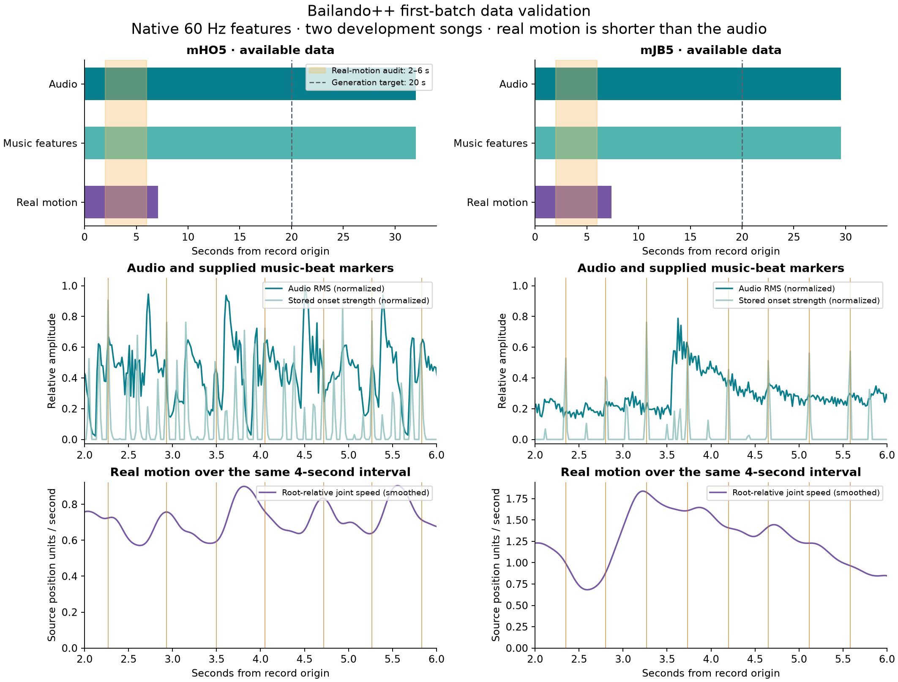

# First-batch data validation

Validated November 6, 2026 in Conda environment `10703`. The user confirmed
AIST application submission and authorized dataset use. No Modal job was launched.

**Two development pairs are downloaded and structurally validated.** Original
native music features are exported for the ++ loader. Model inference and visual
motion/audio synchronization checks remain pending.

| Case | Song | WAV duration | Music array, 60 Hz | Real motion, 60 Hz | Music beats in [2, 6) s |
|---|---|---:|---|---|---:|
| A | mHO5 | 32.000 s | 1,920 × 438 | 426 × 72; 7.100 s | 7 |
| B | mJB5 | 29.538458 s | 1,773 × 438 | 443 × 72; 7.383333 s | 8 |

The policy uses the first 55 feature channels. Both WAVs are stereo, 48,000 Hz,
PCM-24. Music-feature duration differs from audio duration by 0 and 11.542 ms,
respectively: both are within one native frame (16.667 ms). Stored beat markers
in zero-based column 53 are binary; full-song beat counts are 49 and 63.

## Checks and provenance

- Downloaded motion records passed ZIP CRC verification; their SHA256 hashes match
  the extraction inventory. WAV and derived-feature hashes are in the data manifest.
- Record/song IDs match; neither record appears on the upstream exclusion list.
- Music, motion, and audio arrays contain only finite values. Motion has 24 joints
  × 3 coordinates. Audio amplitudes are within the decoded PCM range.
- Native music arrays are copied without changing their values. Exported arrays
  were reloaded and compared exactly with the originals. All 438 channels are
  retained; the policy selects columns 0–54.
- No 7.5 Hz features were upsampled and no modern audio feature extractor was used.
  The archive lacks a separate native-60-Hz external-feature directory, so we cannot
  establish bitwise equivalence to the separate files used in the authors' training.

The upstream `_prepro_aistpp.py` uses 30,720 Hz audio with the feature extractor's
512-sample default hop. Its full-record export writes `musics_raw` alongside
shorter aligned dance excerpts. This explains why full-song music and real-motion
durations differ. Array lengths, source code, and audio durations support the
60 Hz clock; they do not independently prove perceptual synchronization.

Sources are the [authors' processed archive](https://drive.google.com/file/d/1EGJeBE1fE59ByjxR_-ipwV6Dz-Cx-stT/view)
and [AIST musical pieces](https://aistdancedb.ongaaccel.jp/all_links/all_links_musical_pieces/).
Full record IDs and exact WAV URLs are saved in the manifest.

## Evaluation windows fixed before inference

| Experiment | Planned interval | Reason |
|---|---|---|
| Generation | 20 seconds | Both songs provide sufficient native music and context |
| Generated-only music interventions | [5, 15) seconds | Central ten seconds of each generated clip |
| Real/reconstructed/generated reward controls | [2, 6) seconds; frames [120, 360) | Valid real motion in both records; 240 frames is divisible by eight |

Use valid surrounding data for derivatives and shifts, and exclude loader padding.
Do not tile or pad real excerpts to manufacture longer ground truth. Record any
loader-induced offset explicitly before scoring; the current manifest uses the
native origin and does not fit an offset. These are development songs, not a held-out
generalization set. Four seconds is a small diagnostic sample, not a robust estimate
of dance quality or a substitute for later multi-song evaluation.

## Visual inspection artifact



Orange vertical lines show supplied music beats. Audio RMS and onset strength are
normalized separately over each full song. Joint speed is the mean Euclidean speed
over all 24 root-relative joints (including the zero-speed root), in source position
units per second; the plot applies Gaussian smoothing with sigma five frames.
CSV means use unsmoothed differences entirely within the audit interval. These are
descriptive traces, not model rewards or a numerical synchronization test.

## Reproduction and next gate

Run from the project directory:

```sh
/Users/zhengfeili/opt/anaconda3/bin/conda run --no-capture-output -n 10703 python scripts/prepare_batch01_data.py
```

The script validates local inputs, exports features, writes the manifest and
statistics, and renders the PNG/PDF. It does not download files or run inference.
`pip check` reports no broken requirements; local versions are pinned.

Next: assemble the remote runtime with documented compatibility edits, verify
Modal authentication/credits and spending limits, load both checkpoints, then run
one bounded T4 smoke test. Its deliverables are a 20-second skeleton/audio clip,
model-load diagnostics, and a timing/memory/cost table. Review temporal alignment
before interpreting beat rewards.

- [Data manifest](../../configs/batch01_data.json)
- [Machine-readable validation](data_validation.json)
- [Summary statistics](data_summary.csv)
- [Timeline PDF](data_timeline.pdf)
- [Downloaded source hashes](downloaded_assets.json)
- [First-batch checklist](../../docs/FIRST_BATCH.md)
