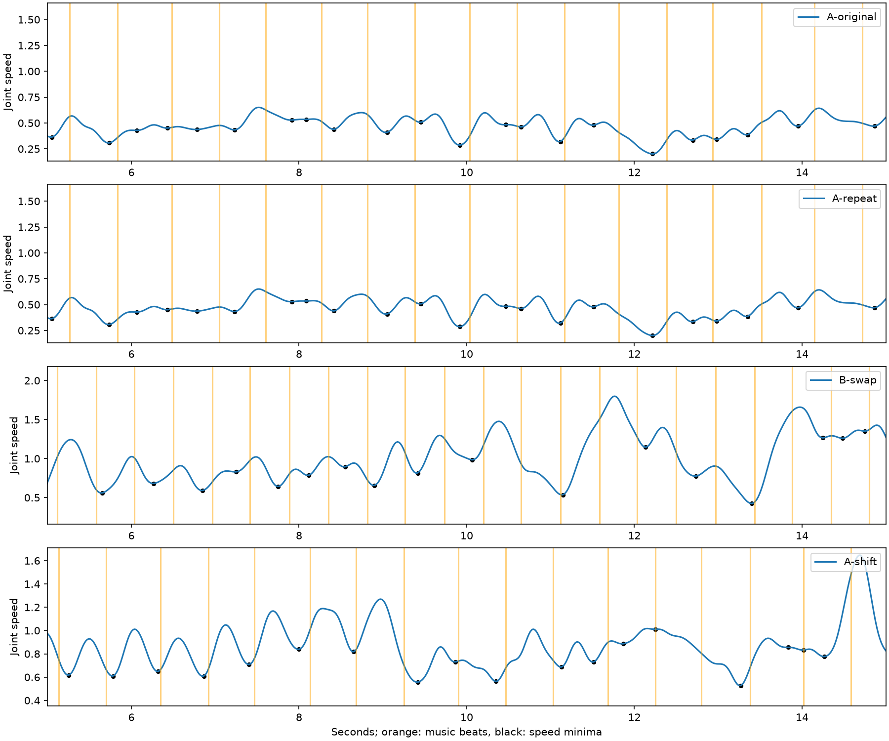

# Fixed-initialization music sensitivity

Run: `musicC-20261106T211618Z`. Reuses the step B clip as A-original. All four start from codes 436/289.

| Case | Code disagreement | Position RMSE | Mean speed | RMS jerk | Beat-to-minimum distance (s) | Beats within 100 ms |
|---|---:|---:|---:|---:|---:|---:|
| A-original | 0.0000 | 0.0000 | 0.4685 | 242.2522 | 0.1510 | 0.3529 |
| A-repeat | 0.0000 | 0.0000 | 0.4685 | 242.2522 | 0.1510 | 0.3529 |
| B-swap | 1.0000 | 0.2238 | 1.0100 | 529.7681 | 0.2023 | 0.3182 |
| A-shift | 1.0000 | 0.1633 | 0.8694 | 406.8571 | 0.1176 | 0.5294 |

Metrics use [5,15) seconds; code comparison uses only fully contained eight-frame bins. Positions are root-relative in source units. Speed averages all 24 joints, including the zero-speed root; jerk is RMS over coordinate components. Music timing diagnostic matches each supplied beat to its nearest local minimum of Gaussian-smoothed mean joint speed (sigma five frames). This is an exploratory diagnostic, not the released reward, and may favor frequent minima. No statistical or perceptual dance-quality claim follows from four runs.

A-shift advances native features by eight frames and audio by 6400 samples at 48 kHz, without wrapping. All runs preserve the original endpoint zero-padding convention. Source timestamps must be advanced by eight frames when interpreting the A-shift manifest.

Human audiovisual review remains pending. Original-song beat comparisons are reported below. Reward controls belong to step D.

## Interpretation and original-beat comparison

A-repeat has identical codes and bitwise-identical raw decoder output to A-original.
Both interventions change every compared upper/lower token in the central interval;
this is evidence of conditioning sensitivity, not evidence of better dance.

| Run | Distance to own beats | Distance to original A beats | Unique upper/lower codes |
|---|---:|---:|---:|
| A-original | 151 ms | 151 ms | 42 / 33 |
| A-repeat | 151 ms | 151 ms | 42 / 33 |
| B-swap | 202 ms | 176 ms | 43 / 47 |
| A-shift | 118 ms | 169 ms | 48 / 52 |

The shifted run is closer to shifted beats under this diagnostic. The swapped
song does not show that pattern. These comparisons are descriptive: beat densities
differ, local speed minima can be plentiful, and autoregressive trajectories diverge.
They do not establish exact time-shift equivariance or perceptual quality.

## Execution and audit notes

All three rollouts returned exit 0 on legacy CUDA. Saved conditioning tensors were
independently compared exactly to the source first-55-channel arrays and the declared
eight-frame transform. The fixed initial codes were checked in all saved sequences.
The baseline pose/context stays song A even in B-swap; `intervention.json` identifies
the conditioning song and timestamp advance, superseding generic smoke labels.

A local duplicate-entrypoint error occurred before submission. A first remote app
failed during startup because its import path omitted `/root/project`; it was stopped
explicitly after startup retries. The corrected app completed all cases. No generated
clip was rerun. The initial download used container paths instead of volume-relative
paths; artifacts were subsequently downloaded without another inference job.
Latest workspace metered cost returned $0.04038749. Billing snapshots can lag and
are not exact per-experiment attribution. See `music_billing_snapshot.json`.

## Clips

- [A-repeat](music_A-repeat.mp4)
- [B-swap](music_B-swap.mp4)
- [A-shift](music_A-shift.mp4)
