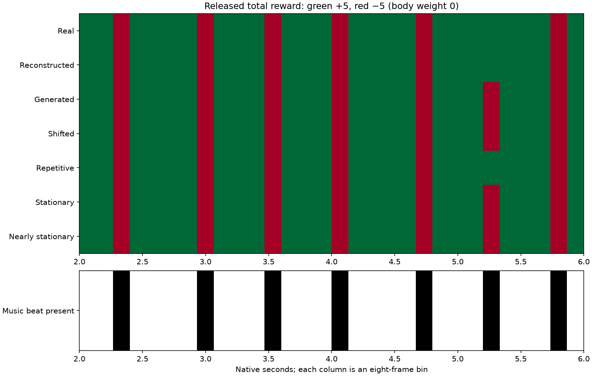
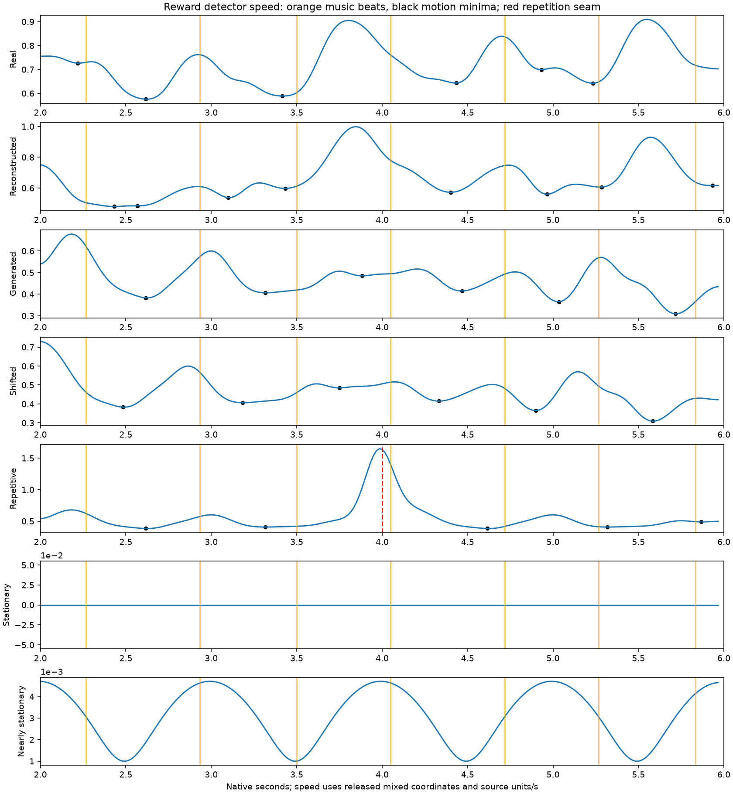

# Step D: released reward audit

Run `rewardD-20261106T215539Z`, song mHO5, native seconds [2,6), frames [120,360).
The released reward gives positive means even when no music-beat bins are matched.
Repetition scores above the cached generated clip despite a large discontinuity.
These are supported limitations of this reward on this sample, not proof of an RL exploit.

## Seven-control comparison

| Control | Mean reward | Music bins hit | Mean reward on music bins | Mean joint speed | RMS jerk |
|---|---:|---:|---:|---:|---:|
| Real | 3.000 | 1/7 | -3.571 | 0.7161 | 381.06 |
| Reconstructed | 3.000 | 1/7 | -3.571 | 0.6553 | 306.49 |
| Generated | 2.667 | 0/7 | -5.000 | 0.4668 | 269.32 |
| Shifted | 2.667 | 0/7 | -5.000 | 0.4626 | 272.53 |
| Repetitive | 3.000 | 1/7 | -3.571 | 0.5478 | 5675.04 |
| Stationary | 2.667 | 0/7 | -5.000 | 0.0000 | 0.00 |
| Nearly stationary | 2.667 | 0/7 | -5.000 | 0.0031 | 0.02 |

Speed is mean over 24 root-relative joints including the zero-speed root, in source
position units/s. Jerk is RMS over coordinate components in source units/s³;
no smoothing is applied to these metrics. Root velocity is excluded from physical
joint metrics but retained in the unchanged reward input. Low jerk alone is not
success: stationary motion has zero jerk and no dance.

## What the reward actually checks

| Music beat in bin | Detected motion beat in bin | Beat reward |
|---|---|---:|
| No | Either | +5 |
| Yes | Yes | +5 |
| Yes | No | −5 |

There are 30 eight-frame bins; 7 contain music beats and 23 do not. Thus every
control receives +115 from bins without music beats. Missing all seven music bins
still yields (115 − 35)/30 = **2.667**. The primary body weight is zero, so total
reward equals beat reward for all seven valid controls. The CSV also reports the
unweighted body term, exposed by a separate diagnostic call with weight one.
Its mean is 1.0 except reconstruction (0.768); it does not affect the ranking.



## Examples to inspect

**1. Stationary ties generated: reward is not an activity measure.**
[Stationary clip](reward_stationary.mp4) and [generated clip](reward_generated.mp4)
both score 2.667 and miss all seven music bins. Generated motion has six detected
motion beats, all outside music bins; stationary motion has none. Every reward bin
is identical between these two controls. This is a concrete example where reward
cannot distinguish movement from no movement under the tested music/phase.

**2. Repetition wins despite its seam: reward is not a smoothness measure.**
[Repetitive clip](reward_repetitive.mp4) repeats generated seconds [2,4) twice.
The seam is at native second 4, or second 2 in this four-second clip. Its jerk is
5675 versus 269 for [generated motion](reward_generated.mp4), about 21 times larger,
yet reward rises from 2.667 to 3.0. See the [sampled frames](reward_repetitive_contact.png). It matches one music bin and is not penalized
for its seam. This establishes a ranking mismatch with smoothness; it does not
show that the seam caused the extra match or that all repetition is undesirable.

**A narrow success:** real, reconstructed, and repetitive controls each receive +5
in the matched bin [5.2,5.333...) seconds (zero-based audit bin 24), where generated
motion receives −5. The reward implements its specified bin-level coincidence
rule correctly. Most real dance beats still miss these strict bins; perceptual
synchronization and detector suitability are separate questions.



The timeline uses the released detector's mixed-coordinate speed: Gaussian sigma
five frames, strict local minima, and the original difference-index convention
(no +1 correction). Black markers are detected motion beats; orange lines are
supplied music beats; the dashed red line marks the repetition seam. Axes differ
between rows, especially the nearly stationary row.

## Other findings and negative results

- Advancing generated motion eight frames against unchanged music does not change
  the reward here: both original and shifted miss all seven music bins. This single
  phase intervention does not establish general shift invariance.
- Nearly stationary motion has mean speed 0.00309 versus 0.4668 for generated
  motion, but receives the same reward. Its smoothed valleys contain equal adjacent
  float32 samples at local indices 29/30, 89/90, 149/150, and 209/210. Strict minima
  detection therefore finds no beats. This is a detector plateau sensitivity,
  not evidence that tiny motion necessarily creates spurious beats.
- A supplementary **invalid-pose** probe (all-zero finite coordinates) produces
  NaNs in all 30 bins despite body weight zero. Body-normal normalization divides
  by zero before multiplication by the zero weight. All seven valid controls
  remain finite. This establishes a numerical edge case, not a failure observed
  on the generated dance.

## Coordinates, context, and scope

Real motion uses root-relative non-root joints plus forward root displacement in
channels 0:3, matching the decoder/reward convention. The original training
conversion is in `motion_vqvae.py`. Reconstruction decodes the 54 real-motion code
pairs cached by the smoke test from its full 432-frame padded encoder input.
Only valid frames 120:360 are scored. No policy sampling or RL update was run.

Generated and shifted controls use cached raw decoder output. The nearly stationary
control applies rigid yaw (0.5 degrees, 0.5 Hz) to the valid real pose at frame120,
with fixed root. The reference body's upper/lower normal lengths were checked.

The reward is called on each 240-frame crop, including its own smoothing boundary
conditions. Training typically decodes a separate 224-frame action window. This
experiment audits the released reward function, not an exact replay of a training
minibatch. Decoder context and crop boundaries must be traced in step E. One song
and four seconds cannot establish generalization, perceptual quality, or RL behavior.

All clips contain the same source audio cropped to seconds 2–6. Their displayed
timestamps are clip-relative; add two seconds for native song time. The renderer
recenters the root and is not a diagnostic of global drift or foot contact.

## Validation and execution

The unchanged upstream reward ran on one Tesla T4 with Python3.8.10,
PyTorch1.6.0+cu101, NumPy1.19.5, and SciPy1.5.4. The decoder loaded strictly from
the recorded epoch500 checkpoint. Scoring took 0.0115 s; the worker measured
9.19 s total and 260.1 MiB peak allocated GPU memory. These exclude container startup.

An independent local implementation reproduced every detected dance bin and all
210 beat-reward values exactly, then verified finite total rewards equal that truth
table. This validates implementation consistency, not perceptual beat labels.
The seven inputs and all per-bin outputs are saved in `results.npz`.

The first submission stopped locally before GPU execution because a dependency
build step followed Modal's file mounts. SciPy was moved before those mounts;
one subsequent GPU audit completed with exit0. No long training was launched.
Latest workspace metered cost read $0.04038749, unchanged from the prior snapshot;
this may lag and must not be interpreted as zero incremental audit cost. The
billing snapshot is local-only and contains account-specific information.

## Artifacts and reproduction

- [Machine-readable table](reward_audit.json), [CSV](reward_audit.csv)
- [Runtime, hashes, and control provenance](reward_runtime.json)
- [Real clip](reward_real.mp4), [reconstruction](reward_reconstructed.mp4)
- [Shifted clip](reward_shifted.mp4), [nearly stationary](reward_nearly_stationary.mp4)
- Local raw run: `runs/batch01/rewardD-20261106T215539Z/`
- Modal volume: `bailandopp-batch01`, `runs/rewardD-20261106T215539Z/`

```sh
python scripts/prepare_reward_audit.py
python scripts/check_modal_account.py
modal run infra/modal_reward.py
# Use the run ID printed by Modal; existing results need only this local command:
python scripts/summarize_reward_audit.py rewardD-20261106T215539Z
```

Use Conda environment `10703` locally. Shared-account assets must already be staged;
this launcher is not an independent-account bootstrap. Next is step E: trace one
rollout/window and explain how its actions, decoder context, music, and rewards
line up. Independent TD/gradient verification and RL training remain future work.
