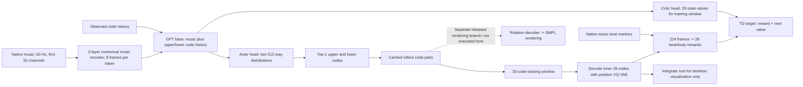
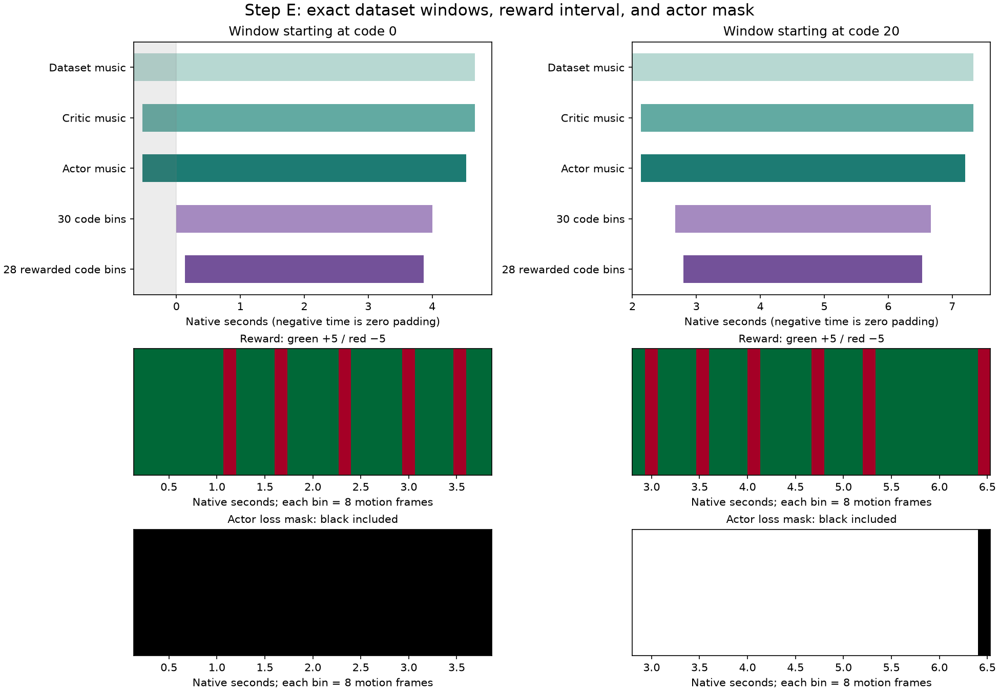
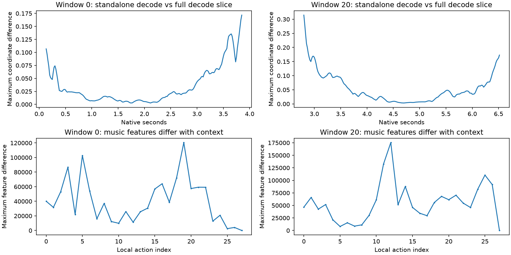

# Step E: one rollout traced into training windows

**The cached supervised rollout can be traced through the released dataset, actor,
critic, decoder, and reward paths. No weights were updated.**

Run: `traceE-20261106T221045Z`. Source: `smokeB-20261106T204747Z`, mHO5,
150 upper/lower code pairs including initialization, 1,200 generated frames.
The initial pair is (436,289). The policy checkpoint file says epoch400 but its
stored epoch is440; the decoder is epoch500. Hashes remain in the baseline manifest.

Two complete windows are exported: codes [0,30) and [20,50). They overlap in codes
20–29. This is replay of a supervised trajectory using the training path, not a newly
sampled RL rollout. The released RL initialization zeros the input root whereas the
supervised smoke initialization did not. That difference remains explicit.

## Pipeline and roles



The actor and critic methods run the music encoder and GPT base under `no_grad`.
The actor head and critic head are the intended update targets in their respective
branches. The VQ-VAE does not receive gradients through the detached reward.
This trace checks forward behavior; actual gradient/parameter changes remain a
next-batch verification, not a result claimed here.

## Exact array slices

All intervals below are half-open. A code pair nominally spans eight native frames.
That does not mean its decoded frames depend only on that pair: the CNN decoder
uses neighboring codes.

| Object | Shape, excluding batch | Window0 | Window20 |
|---|---|---|---|
| Dataset codes | 30 × 2 | codes [0,30) | codes [20,50) |
| Dataset music including context | 320 × 55 | frames [−40,280) | frames [120,440) |
| Critic input codes | 29 × 2 | [0,29) | [20,49) |
| Critic music after dropping first8 | 312 × 55 | [−32,280) | [128,440) |
| Actor input codes | 28 × 2 | [0,28) | [20,48) |
| Actor music, another8 removed at right | 304 × 55 | [−32,272) | [128,432) |
| Actor targets / decoder input | 28 × 2 | codes [1,29) | codes [21,49) |
| Standalone decoded reward input | 224 × 72 | frames [8,232) | frames [168,392) |
| Reward music beats | 224 | frames [8,232) | frames [168,392) |
| Rewards / actor mask | 28 | all mask entries1 | only local entry27 is1 |
| Critic values | 29 | V0…V28 | V20…V48 |

Negative frame indices denote left zero padding, not negative-time song content.
The first and last eight frames of the dataset's 240-frame beat vector are omitted
when scoring the inner28 codes. The decoder's first three output channels remain
root displacement/velocity for reward; root integration is not performed before scoring.



## Three concrete actions

Critic values below come from a **fresh random critic**, initialized with seed42
and saved as `critic_initial.pt`. They illustrate the computation and have no claim
to prediction quality. They are not the critic from the published RL checkpoint.

| Window/local action | Cached target upper/lower | Native frames | Reward | V(current) | V(next) | TD target, gamma1 | Actor mask |
|---|---|---|---:|---:|---:|---:|---:|
| 0/0 | 289/440 | [8,16) | +5 | 1.546752 | 1.203827 | 6.203827 | 1 |
| 0/27 | 428/69 | [224,232) | +5 | 1.576192 | 1.393984 | 6.393984 | 1 |
| 20/27 | 432/411 | [384,392) | -5 | 1.043499 | 1.343184 | -3.656816 | 1 |

For the later window's final action, the sampler observes code pairs20…47 and
music frames [128,432), then predicts pair48 = (432,411). Pair48 corresponds to
native frames [384,392), or [6.400,6.533...) seconds. The training window decodes
pairs21…48 together. Its last reward bin contains a music beat but no detected
motion beat, so r=−5. V48 is the bootstrap value for the state ending in pair48.
The target is −5+1.343184=−3.656816; subtract V47=1.043499 for the TD error.
The source applies no terminal mask to this target.

The first action uses only initial pair0 and music frames [−32,56) during sampling.
Its target is pair1=(289,440), nominally frames [8,16). The exact sampler history
and music bounds for all56 traced actions are in the [action table](rollout_trace_actions.csv).

## Why the training window cannot be replaced by a cached motion slice

| Comparison | Window0 | Window20 |
|---|---:|---:|
| Maximum coordinate difference: standalone decode vs full-decode slice | 0.171768 | 0.314707 |
| Reward bins changed by that decoder context | 0/28 | 2/28 |
| Actor-window greedy pairs differing from cached actions | 3/28 | 27/28 |
| Original-sampling-context greedy replay | 28/28 match | 28/28 match |

**Decoder context:** both decoder outputs were scored with the same224-frame beat
vector and identical reward crop boundaries. In window20's last bin, standalone
training decode scores −5 while the full-decode slice scores +5. Thus this example
isolates a decoder-context effect on reward; it is not a music timestamp change.
Step D remains a valid full-motion control audit, but its cached slices are not
interchangeable with the training reward inputs.

**Policy context:** the sampling function retains at most28 history pairs. Dataset
windows reset history and positions at their start. In later windows, early local
positions have less past history than the sampler originally had. Additionally,
the bidirectional music encoder receives a different extent of future music.
Consequently, teacher-forcing the whole actor window need not reproduce all the
original greedy actions. In window0, local indices1,5,19 differ; in window20,
indices0–26 differ. All original-context replays match. The later window masks
those27 early positions out of actor loss; the final included action matches.
The critic still trains across its whole window. These are context differences
to preserve and understand, not evidence of corrupted weights or stochastic sampling.

**Music look-ahead correction:** ±40 frames is the attention band of each of the
three music-attention layers, not the whole encoder's receptive-field limit.
Three layers allow paths up to120 frames away, clipped by the supplied music extent.
Each token groups eight encoded frames. For example, training-window0's first
music token nominally uses frames8–15, with possible forward paths to frame135;
its original sampling call supplies frames only through55. The causal GPT mask
does not remove future information already mixed into those music tokens.
The exact learned influence is data-dependent; this is a structural reachability
bound. Earlier descriptions of a ±40-frame band should be read as per-layer.



The music-feature differences shown are absolute differences in an internal,
unbounded representation, not a quality metric. At each window's last actor slot,
the context matches sampling and the feature difference is zero in this replay.

## Masks, losses, and the next-update checklist

The dataset produces121 possible30-code windows from this20-second rollout.
Across the complete deterministic window set, actor masks include target codes1…148
once each. Code0 is initialization; code149 only provides trailing context in the
last dataset window. However, the actual loader samples **with replacement**, so
that once-each coverage is not guaranteed in any epoch.

The released actor loss uses the mask; the critic loss does not:

```text
nll[j] = CE(upper_logits[j], upper_target[j]) + CE(lower_logits[j], lower_target[j])
target[j] = stop_gradient(reward[j] + gamma * value[j+1])
delta[j] = target[j] - value[j]
actor_loss = sum(mask * nll * stop_gradient(delta)) / sum(mask)
critic_loss = mean(delta ** 2)
```

Here gamma=1, entropy coefficient=0, and actor-loss multiplier=1. The source
alternates five actor minibatches then five critic minibatches, starting with actor
updates because pretrain_critic_epoch=0. The counter restarts each epoch.
With this single rollout and batch64,121 samples give only **two minibatches**:
a naive tiny RL run would never reach a critic update. At least six minibatches
are needed to reach the first critic branch; ten exercise the full cycle.
Changing the data amount or batch/sampling schedule must be recorded explicitly.

Local float64 calculations checked TD targets and summed cross-entropy against
saved runtime outputs. Maximum absolute differences were below2.4e−7 for targets
and1.9e−6 for NLL. Illustrative scalar losses are saved in the validation JSON.
No `backward` or optimizer step was executed. The next batch must independently
verify actor and critic gradients, optimizer membership, parameter deltas,
frozen modules, and both schedule branches on disposable copies.

## Artifacts and reproduction

- [Action-by-action CSV](rollout_trace_actions.csv)
- [Independent checks and selected values](rollout_trace_validation.json)
- [Runtime, source hashes, loading diagnostics](rollout_trace_runtime.json)
- Raw windows and initial critic: `runs/batch01/traceE-20261106T221045Z/`
- Same directory on Modal volume `bailandopp-batch01` under `runs/`.
- [Batch closure and spending](summary.md)

Each NPZ contains dataset music/padding indices, codes, actor/critic slices,
beat labels, mask, standalone decoded raw motion, cached full-decode slice,
per-bin rewards,29 values, logits, NLL, entropy, TD targets/errors, music features,
and original-context greedy replay results. The initial critic is reproducible
from its saved state/hash; do not rely on seed alone across different runtimes.

```sh
python scripts/prepare_rollout_trace.py
python scripts/check_modal_account.py
modal run infra/modal_trace.py
# Reuse existing results for local checks and plots:
python scripts/summarize_rollout_trace.py traceE-20261106T221045Z
python scripts/write_batch01_trace_report.py
```

Use project Conda environment10703 locally. The worker uses legacy PyTorch1.6.0
on one T4. No generation, decoder training, or RL update was performed.
